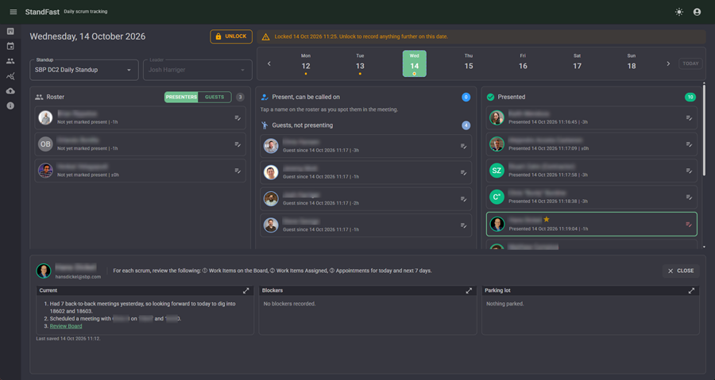
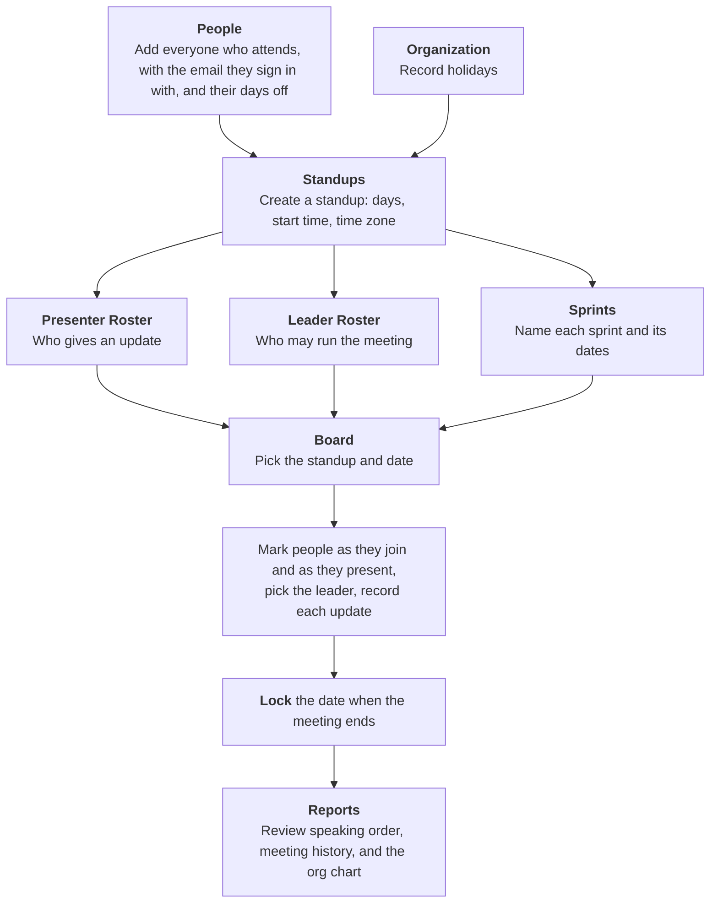
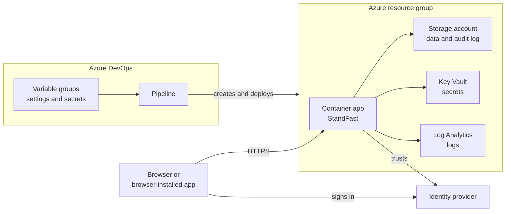
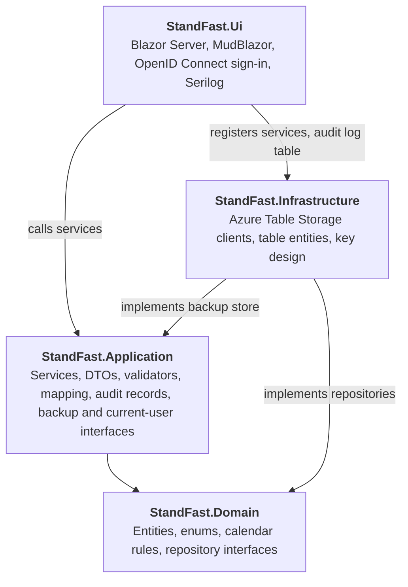

# <a id="about">ℹ️</a> About StandFast

StandFast is a web app for the person who runs a team's daily standup meeting. It records who joined, who has given their update and in what order, and what each person said, next to what they said last time. Every meeting stays available as it was recorded, and reports show how meetings ran over time.

StandFast does not host the call and does not connect to any meeting or chat service. Anyone the sign-in service lets in can view and change everything, because there are no roles. The repository deploys to Azure only.



# <a id="table-of-contents">📖</a> Table of Contents

- [ℹ️ About StandFast](#about)
- [📃 Overview](#overview)
  - [Terms](#terms)
  - [Using StandFast](#using-standfast)
  - [Capabilities](#capabilities)
- [💻 Technical Overview](#technical-overview)
- [📐 Architecture Summary](#architecture-summary)
- [🚀 Run Locally](#run-locally)
- [☁️ Run in Hosted Environment (Azure)](#run-hosted)
  - [Set up and deploy](#set-up-and-deploy)
  - [Optional settings](#optional-settings)
  - [Access an existing deployment](#access-an-existing-deployment)
- [⚙️ Development and Support](#development-and-support)
  - [Settings](#settings)
    - [Values set for you](#values-set-for-you)
    - [Time zones](#time-zones)
- [🚧 Change Summary](#change-summary)

# <a id="overview">📃</a> Overview

## Terms

| Term | Meaning |
| ---- | ------- |
| Standup | A recurring meeting set up in StandFast, with a name, the days it runs, a start time, a time zone, and two rosters. |
| Presenter Roster | The people expected to give an update at a standup. |
| Leader Roster | The people who may run a standup. One person can be on both rosters. |
| Guest | Someone attending a standup who is not on its Presenter Roster. A guest can have notes recorded but takes no turn. |
| Board | One standup on one date, where attendance and updates are recorded. |
| Turn | A presenter's position in the order people gave their updates on a date. |
| Update | What a presenter said, in three parts: current update, blockers (what is in their way), and parking lot (topics to take up after the meeting). Each is edited as formatted text and saved as [Markdown](https://www.markdownguide.org/basic-syntax/), a plain-text formatting syntax, which can also be edited directly. |
| Lock | Closing a date after the meeting, so what was recorded cannot be changed by accident. |
| Sprint | A named stretch of dates a standup's team works to, such as "Sprint 29". Each standup has its own sprints, and they never overlap. |
| Holiday | A date the whole organization has off, as a full day or a half day. |
| Days off | A span of whole days one person is away, with an optional note. |
| Working day | A Monday to Friday date, counted as a full day, less a holiday on it: none left for a full-day holiday, half for a half-day one. |
| Identity provider | The external sign-in service StandFast trusts to say who a user is, using the [OpenID Connect](https://openid.net/developers/how-connect-works/) standard. |

## Using StandFast



People, holidays, standups, rosters, and sprints are set up ahead of time and changed as the team and calendar change. Board through Lock repeats at every meeting.

## Capabilities

| Capability | Outcome | Limitations |
| ---------- | ------- | ----------- |
| Multiple standups | Each standup keeps its own schedule, time zone, rosters, and history. | |
| Attendance and speaking order | One tap marks someone as joined and a second as having presented, so the board shows who is still waiting. Each card shows the turn the person took last time, so the order can be varied. Marking the first person on a date also marks you, when your own card is still on the roster and you are not off that date. | Guests cannot be marked as presented. A presenter with days off covering the date cannot be marked present; tapping them shows a warning instead. |
| Sprints and time off | The board shows the sprint covering its date, in green beside the date, with the working days left in it counting that date. A card is marked when the person is off that date or has days off in the rest of the sprint; hovering shows their days off and the working days they have left to contribute. | Working days are Monday to Friday, whatever days the standup runs. Holidays apply to everyone. Days off are whole days. |
| Leader | Records who ran the standup on each date. | Only people on the Leader Roster who are attending that date can be picked. |
| Context at a glance | Each card shows the person's photo, their time zone offset from the standup, and their time with the organization, with location, start date, and title or role on hover. | Shown only for details recorded in People. |
| Updates | Each person's update, blockers, and parking lot are captured with formatting, and last time's entry can be copied in with one click. | Guests get one notes box. |
| History | Any past date opens exactly as recorded, and a locked date cannot be changed by accident. | A locked date must be unlocked to change it. |
| Reports | A chart of each person's turn over time, a table of the days a standup ran, how many presented, and how long it took, a table of how often each person presented and how long their turns ran, and an org chart of everyone under their supervisor. | A standup's reports cover a period running back from today, a year at most. The org chart covers all of People and shows an inactive person only when someone active reports up through them. |
| People directory | One list of everyone, with photo, title or role, supervisor, organization, department, location, time zone, start date, notes, and days off. It lists active people, or only inactive people while Show inactive is on, and can be narrowed to presenters, leaders, people on neither roster, or any combination of those. | A supervisor is optional, and a save is refused when following supervisors upward would loop back. Removing a person leaves their direct reports with no supervisor and removes their days off. |
| Organization | Holidays the whole organization takes, each a full or half day, on one Holidays tab. | One holiday per date. |
| Backup and restore | The whole data set downloads as one file and can be restored into any StandFast environment. | Restoring replaces all data. The audit log and each user's own settings are not included. |
| Appearance | Light or dark mode follows each user to any browser. | |
| Browser-installed app | StandFast can be installed from the browser to open in its own window with its own icon. | Offered by Edge and Chrome. |

# <a id="technical-overview">💻</a> Technical Overview

| Element | Role | Needed for |
| ------- | ---- | ---------- |
| [.NET SDK](https://dotnet.microsoft.com/download/dotnet/10.0), at the version in [global.json](global.json) | Builds, runs, and tests the app. | Local |
| [Visual Studio 2026](https://visualstudio.microsoft.com/downloads/) or [Visual Studio Code](https://code.visualstudio.com/download) with [C# Dev Kit](https://marketplace.visualstudio.com/items?itemName=ms-dotnettools.csdevkit) | Editing and debugging. Visual Studio Code runs and debugs with F5 from [.vscode](.vscode). | Local, optional |
| C#, Blazor Server, and MudBlazor | Language and UI. Packages are versioned in [Directory.Packages.props](Directory.Packages.props) and restored automatically. | Included |
| [Milkdown](https://milkdown.dev) | The formatted text editor in the update, blockers, parking lot, and notes boxes. It is committed already built, under `src/StandFast.Ui/wwwroot/lib`; see Browser libraries under [Development and Support](#development-and-support). | Included |
| [Node.js](https://nodejs.org) | Rebuilds the browser libraries after their versions change. | Optional |
| [Azurite](https://learn.microsoft.com/azure/storage/common/storage-use-azurite) | Stands in for Azure Table Storage. | Local |
| OpenID Connect identity provider | Sign-in. Any provider that publishes a discovery document and supports the authorization code flow with a client secret, such as [Kinde](https://kinde.com). | Local and hosted |
| [Azure subscription](https://azure.microsoft.com/free/) | Hosts the app on Azure Container Apps with Azure Table Storage, all defined in [infra/main.bicep](infra/main.bicep). **Owner** or **User Access Administrator** is needed once, to grant the pipeline its role. Using a custom domain assumes familiarity with Azure Container Apps custom domains and DNS. | Hosted |
| [Azure DevOps](https://learn.microsoft.com/azure/devops/pipelines/get-started/what-is-azure-pipelines) project | Pipelines build, test, and deploy; variable groups hold the deployment settings and secrets. | Hosted |
| [Azure CLI](https://learn.microsoft.com/cli/azure/install-azure-cli) | Grants the pipeline its role from the command line. [Azure Cloud Shell](https://learn.microsoft.com/azure/cloud-shell/overview) includes it. | Hosted, optional |
| GitHub repository admin rights | Applies branch policy; see [Development and Support](#development-and-support). | Optional |
| AI coding assistant | Assistive development. | |

# <a id="architecture-summary">📐</a> Architecture Summary



| Part | Role | Locally |
| ---- | ---- | ------- |
| Container app | Runs StandFast, a Blazor Server app: pages are rendered on the server and kept live in the browser over a persistent connection. | `dotnet run` or the editor. |
| Storage account | Tables hold every record and the audit log. A blob container holds the Data Protection key ring that every replica shares. | Azurite. |
| Variable groups | Hold every deployment setting and secret, which the pipeline passes to the deployment. A group can instead be [linked to an existing Key Vault](https://learn.microsoft.com/azure/devops/pipelines/library/link-variable-groups-to-key-vaults). | `appsettings.json` and user secrets. |
| Key Vault | Created by the deployment. Secrets passed in by the pipeline reach the app from here, not as plain environment variables. | User secrets. |
| Log Analytics | Collects the app's console logs. | The console. |
| Identity provider | Signs users in; StandFast never sees a password. | The same provider, with the local address registered. |
| Pipeline | Builds and tests every change to a release branch, then creates or updates every Azure resource and deploys the app. | Not used. |

The code is four projects, and each arrow is a project reference. Only Infrastructure knows about Azure Table Storage.



# <a id="run-locally">🚀</a> Run Locally

Run every command from the repository root unless a step says otherwise.

1. Install the .NET SDK and [Azurite](https://learn.microsoft.com/azure/storage/common/storage-use-azurite), and optionally an editor, from the [Technical Overview](#technical-overview).
2. Get the source: `git clone https://github.com/geekfog/StandFast.git`, then `cd StandFast`.
3. Trust the HTTPS development certificate with `dotnet dev-certs https --trust`. This works on Windows and macOS; on Linux, follow [Microsoft's instructions](https://learn.microsoft.com/aspnet/core/security/enforcing-ssl#trust-the-aspnet-core-https-development-certificate) for your distribution.
4. <a id="register-identity-provider"></a>Register an application with your identity provider as a server-side web app that uses the authorization code flow with a client secret:

   | Provider setting | Value |
   | ---------------- | ----- |
   | Allowed callback URL | `https://localhost:7111/signin-oidc` |
   | Allowed logout redirect URL | `https://localhost:7111/signout-callback-oidc` |

   Copy the provider's issuer URL, the client id, and the client secret.
5. Start Azurite as its documentation describes and leave it running. The `.azurite` folder in the repository root is ignored by Git, so it can hold Azurite's data.
6. Store the connection and sign-in settings as [user secrets](https://learn.microsoft.com/aspnet/core/security/app-secrets), which stay outside the repository:

   ```powershell
   dotnet user-secrets set "AzureTableStorage:ConnectionString" "UseDevelopmentStorage=true" --project src/StandFast.Ui
   dotnet user-secrets set "Oidc:Authority" "<issuer URL>" --project src/StandFast.Ui
   dotnet user-secrets set "Oidc:ClientId" "<client id>" --project src/StandFast.Ui
   dotnet user-secrets set "Oidc:ClientSecret" "<client secret>" --project src/StandFast.Ui
   ```

   Every other setting has a working default; [Settings](#settings) lists them all.
7. Start the app with `dotnet run --project src/StandFast.Ui --launch-profile https`, or from your editor. The console shows `Now listening on: https://localhost:7111`, and the tables are created on first start.
8. Open `https://localhost:7111` and sign in through your identity provider.
9. The data starts empty. Set it up as in [Using StandFast](#using-standfast), or restore a backup file on the Backup screen.
10. Check `https://localhost:7111/healthz`, which returns `Healthy` without signing in.
11. To stop, press Ctrl+C in the app's terminal, then stop Azurite.

# <a id="run-hosted">☁️</a> Run in Hosted Environment (Azure)

An Azure DevOps pipeline builds the app on every change to a `release/*` branch and creates every Azure resource itself, so the only manual work is the one-time setup below.

## Set up and deploy

These steps set up the one environment the pipeline defines, PRD. Another environment is another `azure-pipelines-release.yaml` block in `azure-pipelines.yaml`, with its own variable group and Pipelines environment.

1. [Fork](https://github.com/geekfog/StandFast/fork) this repository. The pipeline builds from your fork.
2. [Register an application with your identity provider](#register-identity-provider), without callback URLs for now.
3. In your Azure DevOps project, create an Azure Resource Manager [service connection](https://learn.microsoft.com/azure/devops/pipelines/library/service-endpoints) to the subscription, named `StandFast-Azure`. That name is set in [azure-pipelines.yaml](azure-pipelines.yaml).
4. As someone with **Owner** or **User Access Administrator** on the subscription, give the service connection's principal the **Role Based Access Control Administrator** role at subscription scope, so the deployment can grant the app's managed identity its access. Without it the release fails with `Authorization failed for template resource … Microsoft.Authorization/roleAssignments`. Either:
   - Run this in [Azure Cloud Shell](https://learn.microsoft.com/azure/cloud-shell/overview) (PowerShell):

     ```powershell
     $appId = az devops service-endpoint list --organization https://dev.azure.com/<organization> --project <project> --query "[?name=='StandFast-Azure'].authorization.parameters.serviceprincipalid" -o tsv
     $objectId = az ad sp show --id $appId --query id -o tsv
     az role assignment create --assignee-object-id $objectId --assignee-principal-type ServicePrincipal --role "Role Based Access Control Administrator" --scope /subscriptions/<subscription id>
     ```

   - Or, in the Azure portal: open the service connection in Azure DevOps and note its id, select **Manage service connection roles**, then **+ Add** → **Add role assignment** → **Privileged administrator roles** → **Role Based Access Control Administrator**. Select the member by searching for the service connection id, and on the Conditions tab choose **Allow user to assign all roles (highly privileged)**.
5. Create the [variable groups](https://learn.microsoft.com/azure/devops/pipelines/library/variable-groups) `standfast-vars` and `standfast-prd-vars`, holding every variable [Settings](#settings) marks as required, with `a_AppBase` and `a_RegionToken` chosen by the [resource naming rule](#resource-naming), and authorize both for the pipeline. Mark `a_OidcClientSecret` as secret, or link the group to a Key Vault that holds it.
6. Create the [Pipelines environment](https://learn.microsoft.com/azure/devops/pipelines/process/environments) `StandFast PRD`.
7. Create a pipeline from `azure-pipelines.yaml` in your copy, authorizing Azure DevOps to read it when asked, then push or merge to a `release/*` branch to run it.
8. At the end of the release log, copy the app's address and the two callback URLs, and register the callback URLs with the identity provider.
9. Open `<app address>/healthz`, which returns `Healthy`, then open the app's address and sign in.
10. Set up the data as in [Using StandFast](#using-standfast), or restore a backup within the app, taken from another environment.

## Optional settings

Both are variables in the environment's variable group and take effect on the next release.

**`a_AllowedBranches`** limits which branches may release to the environment. Write branch names without `refs/heads/`, separated by `|`; a top-level folder followed by `/` matches every branch in it, and matching ignores case. For example, `release/` allows every release branch, and `release/01.02|release/01.03` allows only those two. Left unset or empty, every branch that triggers the pipeline releases.

**`a_CustomDomain`** serves the app on your own domain, such as `standup.example.com`, instead of the generated Container Apps address. The release binds the domain and issues a free managed certificate for it, once the domain's DNS records exist; the release log prints the domain verification id they need. Afterwards, register the callback URLs on the new domain with the identity provider.

## Access an existing deployment

Open the custom domain if one is set, or the container app's **Application Url** in the Azure portal, which the release log also prints. StandFast admits anyone the identity provider signs in for its application, so who can use it is controlled at the provider.

# <a id="development-and-support">⚙️</a> Development and Support

| Topic | Detail |
| ----- | ------ |
| Build | `dotnet build StandFast.slnx` |
| Test | `dotnet test StandFast.slnx`. The Azurite integration tests skip themselves when Azurite is not running. The pipeline runs the same build and tests on every pull request. |
| Contributing | Branch `feature/*` from the release branch you are targeting and open a pull request into it. Every merge into a release branch deploys. Add a line for the change under that version in the Change Summary below. |
| Browser libraries | [src/StandFast.Ui.ClientLibs](src/StandFast.Ui.ClientLibs) pins the browser libraries in its `package.json` and bundles them into `src/StandFast.Ui/wwwroot/lib`, which is committed, so building and deploying need no Node.js. After changing a version, run `npm install` and then `npm run build` in that folder, and commit the rebuilt files. |
| Versions and branches | `VersionPrefix` in [Directory.Build.props](Directory.Build.props) is the only version. Each `release/MM.mm` branch is cut from the previous one, and the newest is the default branch. |
| Taking updates | Each version arrives as a new `release/MM.mm` branch in this repository. In your copy, run `git fetch upstream`, then push the new branch with `git push origin upstream/release/MM.mm:refs/heads/release/MM.mm`, which deploys it. GitHub's Sync fork button only updates the branch you are on. |
| Branch policy | Maintainer only; a copy can skip it. [GitHub rulesets](https://docs.github.com/repositories/configuring-branches-and-merges-in-your-repository/managing-rulesets/about-rulesets) in [.github/rulesets](.github/rulesets) allow changes to release branches only by pull request and make every release branch but the newest read-only. The [Branch policy](.github/workflows/branch-policy.yml) workflow applies them and needs a repository secret `RULESET_ADMIN_TOKEN`: a fine-grained personal access token for this repository with **Administration: Read and write**. GitHub turns Actions off in a fork until the owner enables them. |
| Ownership | Maintained by Hans Dickel ([geekfog](https://github.com/geekfog)). |
| Support | [GitHub Issues](https://github.com/geekfog/StandFast/issues). |
| License | [GNU General Public License v3.0](LICENSE). |

## Settings

Locally a setting is a key in a settings file or user secrets. In Azure it is a variable in an Azure DevOps variable group, which the release stage passes to the Bicep, which sets it on the container app. `<env>` is the lower-case environment code, so production reads `standfast-prd-vars`.

| Setting | Purpose | Local: location and value | Azure: group and variable | Needed |
| ------- | ------- | ------------------------- | ------------------------- | ------ |
| `Oidc:Authority` | The identity provider's issuer URL. Every endpoint is read from its discovery document. | User secrets | `standfast-<env>-vars`: `a_OidcAuthority` | Required |
| `Oidc:ClientId` | The confidential client id from the identity provider. | User secrets | `standfast-<env>-vars`: `a_OidcClientId` | Required |
| `Oidc:ClientSecret` | The client secret from the identity provider. In Azure, mark the variable secret; the Bicep stores it in Key Vault as `oidc-client-secret` and the container app reads it through a Key Vault reference. | User secrets | `standfast-<env>-vars`: `a_OidcClientSecret` | Required |
| `AzureTableStorage:ConnectionString` | Table Storage for all data. Startup fails unless this or `ServiceUri` is set. | User secrets: `UseDevelopmentStorage=true` for Azurite | Not used; see `ServiceUri` under [Values set for you](#values-set-for-you) | Required locally |
| `StandFastUi:DisplayTimeZoneId` | The [time zone](#time-zones) for times that belong to no standup, such as on the Backup screen, and for a standup whose own time zone the server cannot resolve. The board and reports use the standup's own time zone. Empty falls back to the server's zone: your machine's locally, UTC in the container. | User secrets, optional | `standfast-<env>-vars`: `a_DisplayTimeZoneId` | Variable required, value may be empty |
| (none) | The custom domain the app answers on; see [Optional settings](#optional-settings). Empty leaves only the generated Container Apps address. | (none) | `standfast-<env>-vars`: `a_CustomDomain` | Variable required, value may be empty |
| (none) | Branches that may release to this environment; see [Optional settings](#optional-settings). | (none) | `standfast-<env>-vars`: `a_AllowedBranches` | Optional |
| (none) | Region segment of every resource name, such as `<region>`; see the [resource naming rule](#resource-naming). | (none) | `standfast-<env>-vars`: `a_RegionToken` | Required |
| (none) | Azure region everything is created in, such as `northcentralus`. | (none) | `standfast-<env>-vars`: `a_Location` | Required |
| (none) | First segment of every resource name and the `Product` tag, identical across environments, such as `<appbase>`; see the [resource naming rule](#resource-naming). | (none) | `standfast-vars`: `a_AppBase` | Required |
| `AzureTableStorage:TablePrefix` | Prefix on every table name, so one storage account can hold several environments. Letters and digits only, starting with a letter, 21 characters at most. | `appsettings.Development.json`: `StandFastDev`, overridable in user secrets | Set by the Bicep; see [Values set for you](#values-set-for-you) | Committed |
| `AzureTableStorage:CreateTablesOnStartup` | Creates missing tables at startup. Turn off only where the identity has no table-create rights. | `appsettings.json`: `true` | `appsettings.json`: `true` | Committed |
| `BoardLock:GraceMinutes` | Minutes after a date's last presentation within which locking it records the moment Lock was pressed. A lock applied later is dated from the last presentation instead, so a date locked the next morning does not read as a meeting that ran all night. | `appsettings.json`: `60` | `standfast-<env>-vars`: `a_BoardLockGraceMinutes` | Optional; an undefined variable keeps the committed value |
| `BoardLock:MinutesAfterLastTurn` | Minutes added to the last presentation to date a lock applied after the grace window. | `appsettings.json`: `5` | `standfast-<env>-vars`: `a_BoardLockMinutesAfterLastTurn` | Optional; an undefined variable keeps the committed value |
| `SignInSession:IdleDays` | Days a sign-in lasts without the app being opened. Every visit restarts the count, and the sign-in survives closing the browser. | `appsettings.json`: `7` | `standfast-<env>-vars`: `a_SignInIdleDays` | Optional; an undefined variable keeps the committed value |
| `Oidc:CallbackPath`, `Oidc:SignedOutCallbackPath`, `Oidc:SignedOutRedirectUri` | Sign-in and sign-out paths. The two callback paths, after the app's address, are what gets registered with the identity provider. | `appsettings.json` | `appsettings.json` | Committed |
| `Oidc:Scopes` | Scopes added to `openid`, `profile`, and `email`. Only needed when the provider requires another. | `appsettings.json`, optional | `appsettings.json`, optional | Optional |

<a id="resource-naming">**Resource naming rule:**</a> each Azure resource is named `a_AppBase`, the environment code, and `a_RegionToken` run together, plus a short suffix. The storage account, Key Vault, and container registry names must be unique across all of Azure, so choose values no one else uses. Use letters and digits only, with the three parts together at most 22 characters, because storage account and Key Vault names are limited to 24.

### Values set for you

Listed so a value found in a deployed app can be traced to what produced it. None of these is set by hand.

| Value | Set by |
| ----- | ------ |
| `AzureTableStorage:ServiceUri` | The Bicep, from the storage account it creates. The app authenticates with `DefaultAzureCredential`, so no key is involved. Empty locally, which makes the connection string apply. |
| `AzureTableStorage:TablePrefix` | The Bicep, as `a_AppBase` plus the environment code, such as `<appbase>PRD`. |
| `StandFastUi:DataProtectionBlobUri` | The Bicep, from the same storage account. Holds the Data Protection key ring that every replica shares. |
| `StandFastUi:EnvironmentLabel` | The Bicep, as the environment code everywhere except PRD, where it is empty. Drives the navigation menu's environment tag. Unset locally, where the tag shows the `ASPNETCORE_ENVIRONMENT` name. |

### Time zones

`DisplayTimeZoneId` accepts a Windows id or an IANA id, and .NET resolves both on Windows and in the Linux container, so `Central Standard Time` and `America/Chicago` are equivalent. `TimeZoneInfo.GetSystemTimeZones()` lists every id the runtime accepts. A time zone picked for a standup or person is saved as its IANA id on any host, and saving rejects an id the host cannot resolve. `TimeZoneIds` in the Domain project does the conversion, and the standup and person dialogs share the `TimeZoneSelect` picker.

| Windows id | IANA id | Covers |
| ---------- | ------- | ------ |
| `Hawaiian Standard Time` | `Pacific/Honolulu` | Hawaii, no daylight saving |
| `Alaskan Standard Time` | `America/Anchorage` | Alaska |
| `Pacific Standard Time` | `America/Los_Angeles` | Pacific |
| `US Mountain Standard Time` | `America/Phoenix` | Arizona, no daylight saving |
| `Mountain Standard Time` | `America/Denver` | Mountain |
| `Central Standard Time` | `America/Chicago` | Central, the Bicep default |
| `Eastern Standard Time` | `America/New_York` | Eastern |
| `US Eastern Standard Time` | `America/Indiana/Indianapolis` | Indiana (East) |

# <a id="change-summary">🚧</a> Change Summary

*Each entry is a specific version (release/\* branch), in descending order (newest version up top), with a plain bullet list summarizing each change without technical jargon.*

### v01.06.00 — 2026-10-26

- Added an optional supervisor to each person, picked from anyone else in People. Saving is refused when following supervisors upward would loop back to someone already in the chain, and the message names everyone in the loop so you can see which link to change. Removing a person leaves their direct reports with no supervisor.
- Added a fourth report, Org Chart: everyone active in People shown under their supervisor, with one tree for each person who has no supervisor, sorted by name at every level. An inactive person appears, marked inactive, only when someone active reports up through them. The standup and period pickers are hidden for this report, since it covers all of People.
- Added an Organization menu with a Holidays tab, where each holiday is a date, a name, and a full or half day off. Only one holiday can be recorded on a date. Past holidays are hidden until Show past is turned on.
- Added days off to each person, as start and end dates with an optional note, opened from a new icon on their row in People. Removing a person removes their days off.
- Added sprints to each standup, as a name such as Sprint 29 with start and end dates, opened from a new icon on its row in Standups. Sprints of the same standup cannot overlap.
- Made the board show the sprint covering its date beside the date, in green, with the working days left in it counting that date. Working days are Monday to Friday less holidays, and a half-day holiday counts as half a day.
- Marked a card on the board when the person is off that date or has days off later in the sprint. Hovering the marker shows their days off and the working days they have left to contribute.
- Made tapping a presenter who is off on the board's date show a warning instead of marking them present. The first tap of the day also leaves your own card on the roster when you are off that date.
- Made Show inactive on the People screen list only inactive people instead of adding them to the active ones.
- Added Presenters, Leaders, and Neither filters to the People screen, grouped in a box labeled Role. Selecting none lists everyone. Selecting several lists anyone matching at least one, so Presenters and Neither together, for example, lists everyone not on a leader roster alone.

### v01.05.00 — 2026-10-19

- Added a Highlight button to the markdown toolbar, after Strikethrough. Highlighted text is saved as `==text==` and shows with a soft yellow background that reads in both light and dark mode. Typing `==text==` in the formatted text highlights it too.
- Made the roster, present, and presented columns on the board scroll independently on a wide window, so scrolling a long roster leaves the other two columns where they are.
- Moved Save to the left of the update panel's other button, which is now Close while nothing is unsaved and closes the panel. Once there are unsaved edits it becomes Cancel, with an undo icon, which puts the boxes back to what was saved and keeps the panel open.
- Moved the note explaining why the Leader dropdown is empty, such as no leader marked present or as a guest yet, out from under the dropdown and into a tooltip on it, so the dropdowns stay level.
- Changed the initials shown for a person with no photo to come from their first and last name instead of Display As, so a nickname or quotes in Display As no longer produce odd initials.
- Made Save on the update panel delete the update when every box has been emptied. The panel goes back to Not saved yet, and the person's attendance on that date is kept.
- Kept the update panel open on the same person when picking another date, showing their update for the new date. It closes when that person is not on the board for the new date, or when another standup is picked.

### v01.04.00 — 2026-10-15

- Made marking the first person present on a date also mark you, when your own starred card is still on the roster.
- Made the Presenting Order vs Date chart pick out one person at a time. Hovering a line, dot, or name in the legend fades everyone else back and names the person in a popup, with the date and turn when over a dot. Clicking keeps that person highlighted until they or an empty part of the chart is clicked.
- Replaced the chart's colors with six that stay clearly different from each other in both light and dark mode, including for color-blind readers: blue, orange, teal, magenta, yellow, and violet. The seventh person onward gets the same colors again as dashed lines.
- Added a third report, Attendance: one row per person on the presenter roster or who presented in the period, with how many of the days the standup ran they presented on and missed, their attendance as a percentage, and their average, shortest, and longest turn. Missed days count only from when the person joined the roster, and show a dash for someone no longer on it. A turn runs until the next person is marked, and the day's last turn until the lock. Clicking any column heading sorts by it; the table starts sorted by name.
- Moved the build, deploy, and branch-policy pipelines to Ubuntu 26.04.
- Made the update, blockers, parking lot, and notes boxes edit formatted text directly, as it reads once saved, so a long list item wraps under its own text instead of back to the edge of the box. The formatting buttons work on the formatted text, and task checkboxes can be checked off in it.
- Replaced the Preview and Edit buttons with Markdown and Formatted, which switch the boxes between the formatted text and the markdown it is saved as.

### v01.03.00 — 2026-10-02

- Added indent and outdent buttons to the markdown toolbar for nesting bulleted, numbered, and task list items.
- Made Enter on a list item start the next item, renumbering the numbered items that follow, and Enter on an empty item step it out a level or end the list.
- Made the list, heading, and quote buttons leave the cursor in place after the added marker, ready to type, instead of selecting the line.
- Fixed the preview so a list nested under a numbered or bulleted item stays indented under it with no empty line in between, and task list items show only their checkbox instead of a bullet as well.
- Made task checkboxes clickable in the preview, so a task can be checked off without switching back to editing and then saved as usual.
- Made a list keep its items together in the preview, without an empty line between them, and lined up the task checkboxes with their text.
- Made deleting a numbered list item renumber the items after it at the same level.
- Added a start date to each person, set in the person dialog and shown in a Start date column on the People screen.
- Added how long each person has been at the organization to their board card caption, in years, months, weeks, and days as of the board's date, with their start date shown on hover.
- Removed the Prior box from the update panel. A copy icon beside Cancel now brings the previous standup's update, blockers, and parking lot into their matching empty boxes, each headed by an italic line naming the standup it came from. When there is nothing to copy, hovering over the icon says why.
- Fixed the update panel header showing only initials for a person who has a profile photo.
- Replaced each update box's own preview button with one beside the copy icon that switches all three boxes between markdown and preview together.
- Replaced the app icon with the new StandFast speech-bubble checkmark, on the browser tab, the About page, phone and tablet home-screen shortcuts, and the app executable.
- Made every numbered list start at 1 whenever the editor renumbers it, top-level lists included.
- Fixed Save update staying enabled, and the unsaved-changes warning appearing, after a successful save of text that ended in a blank line or space.
- Shortened Save update to Save, gave Cancel, Copy, and Preview/Edit a gray button background, and labeled Copy, Preview, and Edit beside their icons.
- Made the update panel buttons stack two by two beside the person notes when space runs short, and move below them on a narrow screen, so their labels are never cut off.
- Fixed links in the markdown preview looking like plain text. They now show in the accent color and underlined.
- Made StandFast installable as an app from Edge or Chrome, opening in its own window with its own taskbar icon and a title bar matching the light or dark appearance.
- Let guests record notes. A guest card has the notes icon, and its update panel shows a single Notes box without Blockers or Parking lot.
- Made the People page list only active people, with a Show inactive switch to list everyone.
- Kept inactive people off the board's roster, while still showing them on any date they were present, a guest, or presented.
- Reorganized the documentation so a newcomer can read what StandFast does, how to set it up and use it, and how to run it locally and deploy it, in that order, with every setting listed in one place, and steps for running your own copy.

### v01.02.00 — 2026-10-01

- Made release branches the only long-lived branches: each release is cut from the one before it, every merge into a release deploys it, and the newest release is the default branch.
- Made the branch rules kept in the repository the complete set, so a rule removed from the repository is removed from GitHub too.
- Added guests: anyone in People who is not on a standup's Presenter Roster can be recorded as attending without presenting. A Presenters / Guests toggle on the roster picks who it lists, and guests appear in their own list under Present, can be sent back to the roster, and can never be marked as presented.
- Made the Leader dropdown offer only leaders who are attending that date, as a guest or a presenter marked present, and clear the pick when the leader is sent back to the roster.

### v01.00.00 — 2026-09-15

- Created the StandFast solution: a daily scrum board with people, standup definitions, and a date-based board.
- Added the three-column board that opens on today, with the current week across the top and a separate picker for which standup you are running.
- Added tap-to-advance attendance: one tap marks someone present, a second marks them as having presented, and an undo arrow moves them back.
- Added the update panel with a read-only prior update (labelled with the date it came from), a current update, and a blockers box, all with markdown editing, a formatting toolbar, and a preview toggle.
- Added a one-tap copy of the prior update into the current update.
- Added people and standup management screens, including standup rosters and which days a standup runs on.
- Added Entra ID sign-in, with every page requiring a signed-in user.
- Changed sign-in from Entra ID to a standard OpenID Connect provider, configured against Kinde.
- Added auditing of every change through Serilog, written to its own storage table.
- Added the Azure deployment: container build, Bicep for all resources, and the Azure DevOps pipelines that deploy it.
- Added integration tests that run the storage layer against the Azurite emulator, covering the prior-update lookup and roster cleanup, and skipped automatically when the emulator is not running.
- Fixed startup hanging before the app began listening.
- Fixed console logging disappearing when running locally.
- Made deployment self-provisioning: the release stage creates the resource group, brings up the registry and supporting resources, builds the image inside that registry, then deploys the app, so nothing has to be created by hand first and no container registry connection is needed.
- Documented configuration as a single table of everything you set, with the naming used in each place a setting can live and the accepted time zone values.
- Added the previous standup's turn number to each card in the "can be called on" column, with ∞ for anyone who was not there, so whoever went last time can be called first today.
- Added an optional display name and markdown notes to each person, with the display name used everywhere in place of their first and last name when it is set.
- Fixed the board column ordering: the roster is always alphabetical by the name shown, the "can be called on" column runs oldest arrival first, and Presented runs in the order people actually presented.
- Added a Cancel button beside Save on the update panel, which discards unsaved edits.
- Added a Standups column to the People table showing which standups each person is on.
- Added seconds to the presented time on the board, so the order people presented in is unambiguous.
- Fixed the custom web address being lost every time the app was released: it is now part of the deployment itself, and the release reuses the security certificate the site already has instead of replacing it.
- Added a Backup screen that downloads everything the app holds as a single file, and restores one back by replacing all current data. The audit log is left out of both, so restoring an old backup never wipes the record of who changed what.
- Fixed the repository's ignore rules, which were quietly leaving the new backup source folders out of version control.
- Added an F5 launch configuration and build/test tasks for the editor, with Hot Reload switched off to stop a debugger error appearing in the Debug Console on every run.
- Colored the notes icon on a board card once that person has an update recorded for the date, so it is obvious who still owes one, with the outline on the card left to mark whose panel is open.
- Changed Cancel on the update panel to always be available and to close the panel, asking first whether unsaved edits should be lost.
- Corrected the configuration table against what the code and the deployment actually do, and split out a short list of the values that are filled in for you.
- Fixed the build pipeline failing every storage integration test: the check for whether the emulator is running threw instead of answering on an agent that has no emulator, so the tests reported as failures rather than skipping as intended.
- Moved the decision about which branches may deploy to an environment out of the pipeline and into that environment's variable group, as a pipe-delimited list of branch names. Leaving it unset lets any branch that triggers the pipeline deploy there.
- Fixed the deployment creating its resource group under the wrong name, so it is now named for the application, environment and region rather than the application alone.
- Documented the one permission the deployment principal needs beyond Contributor, without which the first deployment fails partway through with an authorization error.
- Stopped requiring a signed-in user for stylesheets, scripts and the Blazor framework files, which were being sent through the identity provider like any page.
- Added a site icon, so the browser stops asking for one that was never there and reporting it as a missing file.
- Made the light and dark mode choice stick to the person who made it, so it comes back the next time they sign in on any browser or machine. Anyone who has never chosen gets light.
- Marked your own card on the board with a dark yellow star after your name, so you can pick yourself out of a long roster at a glance. The app remembers the address you sign in with, keeps it current if it changes at the identity provider, and matches it against your person record.
- Made the notes icon red on any card with an update recorded, in all three columns, so who has already been captured stands out from the green used elsewhere.
- Marked the dates in the week strip that someone presented on, so a day with a finished standup can be spotted without opening it.
- Fixed the deployed app loading but never responding to a click: the container build was leaving Blazor's startup script out of the published output, so the browser asked for a file that was not there. The build now also checks the script is present and fails rather than shipping an app that cannot work.
- Added a Reports screen with a dropdown for choosing which report to show, a picker for the standup, and quick-pick buttons for the last 30, 60, 90 or 180 days or the last year.
- Added the first report, Presenting Order vs Date: a line per person showing the turn they took at each standup over the period, with a dot on the days they presented and ∞ along the bottom for the days they did not. Everyone gets their own color, and once the colors run out they come back as dashed lines so no two people ever look alike. The same numbers are also available as a table under the chart.
- Made a report chart spread across the full width of the browser window and follow it as the window is resized, packing the dates only as tightly as their labels allow before scrolling sideways instead.
- Gave each standup a second roster of the people who may run it, alongside the roster of the people who present. The Standups screen has a button for each, and someone can be on both.
- Renamed the People table's Standups column to Presenters and added a Leaders column beside it, so each person's two kinds of involvement read separately.
- Added a Leader dropdown to the board, beside the standup picker, for recording who ran the standup on the day being viewed. It offers that standup's Leader Roster, applies to that date alone, and can be left empty.
- Added a second report, Standup Activity: a table of the days the standup actually ran, newest first, with the weekday, whether the day is locked or still open, how many people presented, and how many minutes ran from the first person's turn to the lock.
- Turned the week strip's dot orange on a locked day, leaving it green on a day that is finished but still open, so a week shows at a glance which days are closed.
- Greyed out the Lock button until somebody has presented on the date, since a day nobody has spoken on has nothing to close.
- Changed the "can be called on" column to list people alphabetically, the same way the roster does, instead of by who arrived first, so a name sits in the same place in both columns.
- Added a Lock button beside the date on the board, which closes that day's standup so nothing on it can be changed by accident. A locked day still reads in full; unlocking asks first. Locking during or shortly after the standup records the time you pressed it, while locking much later records the last person who presented plus a few minutes, so a day closed the next morning does not read as though the meeting ran that long. How long "shortly after" is, and how many minutes get added, are both settings each environment can change.
- Added an About page to the menu, showing the app icon, a summary of what StandFast is for, and a link to its source repository.
- Added a version number, starting at 01.00, shown on the About page.
- Set out how versions map to release branches, and made the main and release branches accept changes only through pull requests.
- Pull requests into a release branch now get the same build and test check as pull requests into main, and pull request checks never deploy.
- Allowed a folder such as `release/` in the list of branches that may deploy to an environment, so every release branch under it qualifies without being added one at a time.
- Added a parking lot box to the update panel, after blockers, with the same markdown editing, for topics to take offline after the standup. The prior update also shows the previous parking lot when there was one.
- Lined up the bottoms of the four boxes on the update panel, so they end level however their toolbars wrap.
- Showed each person's notes to the right of their name on the update panel.
- Indented bulleted and numbered lists in markdown, so they sit inside the text around them rather than hanging to its left.
- Added a dark red tag at the top of the menu naming the environment, such as Development or DEV, on everything except production.
- Added the abbreviated weekday after the date on the update panel's prior update label, for example (21 Sep 2026 Mon).
- Asked before unsaved edits on the update panel are lost when opening another person's update or switching to another date or standup.
- Added an expand button to the current update, blockers, and parking lot boxes, which fills the update panel with that one box. The person's name, the formatting toolbar, and an X to return to all four boxes sit on a single line above it.
- Showed the prior update, and every box on a locked day, as rendered text only, without the edit and preview toggle.
- Made the navigation menu remember whether each person left it expanded or collapsed, so it comes back that way the next time they sign in on any browser or machine. Anyone who has never collapsed it gets it expanded.
- Made the prior update's heading on the update panel the same height as the headings of the boxes beside it.
- Made the copy prior update button available only while the current update is empty, so it cannot overwrite text already typed.
- Added an optional city, state or region, and time zone to each person, entered on one line of the person dialog and shown in a Location column on the People screen.
- Put first and last name on one line of the person dialog, followed by display as, then email.
- Showed, after each person's status on the board, how many hours their time zone is ahead of or behind the standup's, with their location on hover.
- Showed the board and reports in the standup's own time zone, so changing a standup's time zone changes the times shown for it.
- Time zones for standups and people are saved in the same form on every server, so a standup's time zone reads the same whichever machine last saved it.
- Added an optional title or role to each person, entered below email in the person dialog and shown in a Title/Role column on the People screen.
- Showed each person's title or role when hovering over their status on the board.
- Added organization and department to each person, entered beside title or role in the person dialog.
- Added a profile photo to each person, uploaded or removed in the person dialog beside their name and saved with the rest of the person. The People screen shows it beside the name and the board shows it in place of the initials, ringed in the color of the column the person is in. People with no photo keep their initials.
- Kept you signed in across browser restarts and shutdowns: a sign-in now lasts until the app goes unused for a number of days, 7 unless an environment sets its own, and every visit restarts that count, so regular use including weekends never asks you to sign in again.
- Made the update panel's text boxes fill their column to the bottom and grow with what is typed, so the four boxes use the full height the longest one needs instead of scrolling inside a short box.
- Changed the week strip's dot for a day someone presented on from green to blue, and ringed the dot on the selected day, so it no longer disappears into the green highlight.
- Locked every release branch except the newest automatically: creating a new release branch makes the older ones read-only, ordered by version number so a new major version locks the last minor one before it, and makes the new release the default branch so pull requests target it.
- Allowed pull requests into main only from a release branch.
- Moved the board's date and its Lock button above the Standup and Leader dropdowns, so the week strip sits beside them at the top and the board starts higher on the screen. The week strip's bottom edge lines up with the dropdowns, and messages about the selected date, such as the locked notice, appear above the week strip.
- Made the markdown preview keep the blank lines typed in the editor, one empty line for each, so the spacing matches between editing and preview.
- Kept the top of the board and an open update panel on screen at all times on a wide window, with the roster, present, and presented columns scrolling between them, so running a standup with a long roster no longer means scrolling the page up and down.
